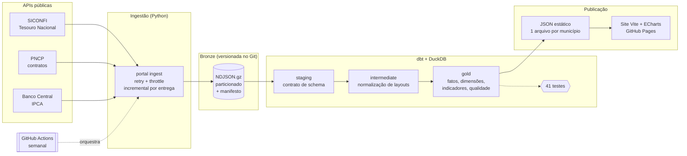

# Portal da Transparência Municipal

[](https://github.com/__OWNER__/portal-transparencia-municipal/actions/workflows/ci.yml)
[](https://github.com/__OWNER__/portal-transparencia-municipal/actions/workflows/pipeline.yml)

Portal que mostra, de forma visual e navegável, o **orçamento, as receitas, os gastos, a despesa com
pessoal e os contratos** da Prefeitura de **Valparaíso de Goiás (GO)**, e de mais sete municípios do
Entorno do DF para comparação, usando apenas **dados públicos oficiais**.

**🔗 Portal:** https://__OWNER__.github.io/portal-transparencia-municipal/
**📚 Documentação do modelo de dados (dbt):** https://__OWNER__.github.io/portal-transparencia-municipal/dbt/

É um projeto de portfólio de **Engenharia de Dados**: o foco é o pipeline (ingestão incremental de
APIs governamentais instáveis, modelagem em camadas, testes de qualidade e publicação automatizada),
com um front-end leve para mostrar o resultado.

---

## O que o portal responde

| Pergunta | Fonte | Visualização |
|---|---|---|
| Quanto a prefeitura arrecadou e gastou no ano? | SICONFI · RREO Anexo 1 | Resumo + série histórica |
| Para onde vai o dinheiro (saúde, educação…)? | SICONFI · DCA Anexo I-E / RREO Anexo 2 | Barras por função com drill-down em subfunções |
| De onde vem o dinheiro? Quanto depende de repasses? | SICONFI · RREO Anexo 1 | Barra segmentada + categorias |
| A prefeitura respeita o limite de gasto com pessoal da LRF? | SICONFI · RGF Anexo 1 | Medidor + histórico com limites legais |
| Quem são os maiores fornecedores? | PNCP · contratos | Ranking + lista pesquisável |
| Como o município se compara aos vizinhos? | Todos | Ranking por indicador per capita |
| Quanto isso vale em reais de hoje? | BCB · IPCA (SGS 433) | Alternância nominal/corrigido |

## Arquitetura



**Por que essas escolhas**

- **DuckDB + dbt, sem servidor.** O volume (dezenas de MB) cabe com folga num banco embarcado. O
  pipeline inteiro roda dentro do GitHub Actions em poucos minutos e não custa nada para manter no ar.
- **Bronze versionada no Git.** As respostas brutas das APIs ficam no repositório (NDJSON.gz,
  gzip determinístico, então o diff só aparece quando o dado muda). Assim o site é reconstruível
  mesmo com as APIs fora do ar, e há histórico auditável de cada retificação.
- **Site 100% estático.** O dbt gera a camada gold, o Python exporta um JSON por município e o
  site só lê arquivos. Não há backend para manter nem banco exposto.
- **GitHub Actions como orquestrador.** Os dados mudam no máximo a cada bimestre, então um cron
  semanal basta e Airflow seria desproporcional. A ingestão é idempotente e incremental, então
  rodar de novo é seguro.

## Destaques de engenharia

### 1. Ingestão incremental orientada a entregas (CDC "de pobre")
Em vez de baixar tudo a cada execução, o ingestor consulta o endpoint `extrato_entregas` do
SICONFI, que lista cada relatório entregue com sua **data de status**. O manifesto
(`data/bronze/_manifest.json`) guarda a versão de cada relatório; só é baixado o que é novo ou
foi **retificado**. Uma execução típica cai de centenas para poucas dezenas de chamadas.
(`src/portal_etl/sources/siconfi.py`)

### 2. Resiliência a APIs instáveis
Todas as chamadas passam por um cliente com **retry exponencial com jitter** (429/5xx/timeouts),
**throttle por host** e timeouts longos (o PNCP leva até 40 s por página). Falhas parciais são
registradas e não derrubam o pipeline: os dados anteriores continuam válidos.
(`src/portal_etl/http.py`)

### 3. Mudança de layout dos relatórios (*schema drift*)
Os relatórios fiscais mudam de formato ao longo dos anos. Exemplos tratados:

| Mudança | Tratamento |
|---|---|
| Até 2017 o RREO agrupava repasses em "Transferências Intergovernamentais"; a partir de 2018 separa União / Estados / Outras | Seed `map_receitas_rreo.csv` cobre os dois layouts; a diferença para o total vira "Outras receitas", então as categorias **sempre somam o total** (testado) |
| Rótulos das colunas mudam (`DOTAÇÃO ATUALIZADA (e)`, `% sobre a RCL` → `% sobre a RCL Ajustada`) | Normalização por prefixo em `int_rreo__anexo01` e `fct_pessoal_lrf` |
| DCA lista o bloco intra-orçamentário depois do bloco principal, com os mesmos códigos | A ordem original das linhas é preservada na bronze (`_ordem`) e usada para cortar o segundo bloco e evitar dupla contagem |
| RREO Anexo 2 não traz o código da função de governo | Casamento por nome sem acento com a tabela oficial (Portaria MOG 42/1999) |
| A API passa a enviar campos novos | `read_bronze` lê com **contrato de schema explícito**: campos novos são ignorados e ausentes viram NULL |

### 4. Qualidade de dados como produto
- **41 testes dbt** (grão único, nulidade, domínios, intervalos, integridade referencial e regras de
  negócio como `pago ≤ liquidado ≤ empenhado`).
- **`mart_qualidade_dados`**: inconsistências encontradas *nos dados declarados pelas prefeituras*
  são publicadas no próprio portal, em "Sobre os dados". Exemplos reais encontrados:
  - RGF de 2016 de Valparaíso declara **limite máximo de 60% da RCL** (o legal é 54%);
  - em 2024 a previsão de receita atualizada (R$ 1,49 bi) foi o **dobro** do arrecadado (R$ 738 mi);
  - divergências entre a despesa liquidada no RREO e no balanço anual (DCA).

### 5. Comparabilidade
Valores em **reais constantes** (IPCA médio do ano → último mês disponível), **per capita** e em
**% da despesa/receita**, sempre **sem as operações intra-orçamentárias**, para não contar o mesmo
real duas vezes.

### 6. Privacidade
CPFs de fornecedores pessoa física são parcialmente mascarados na exportação (LGPD); CNPJs, que
são públicos, aparecem completos.

## Modelo de dados (camada gold)

| Tabela | Grão | Conteúdo |
|---|---|---|
| `dim_municipio` | município | configuração + população |
| `fct_execucao_anual` | município × ano | receita prevista/realizada, despesa autorizada/empenhada/liquidada/paga, nominal e real |
| `fct_receita_origem` | município × ano × categoria | impostos, transferências da União/Estado, FUNDEB, crédito… |
| `fct_despesa_natureza` | município × ano × grupo | pessoal, custeio, investimentos, dívida |
| `fct_despesa_funcao` | município × ano × função × subfunção | saúde, educação, urbanismo… (DCA ou RREO) |
| `fct_pessoal_lrf` | município × ano × período | despesa com pessoal × RCL e limites da LRF |
| `fct_contratos` | contrato | contratos do PNCP deduplicados |
| `mart_indicadores` | município × ano | indicadores comparáveis |
| `mart_qualidade_dados` | achado | inconsistências publicadas no portal |

Dicionário completo e linhagem: [documentação do dbt](https://__OWNER__.github.io/portal-transparencia-municipal/dbt/)
e [`docs/dicionario-de-dados.md`](docs/dicionario-de-dados.md).

## Como rodar localmente

Requisitos: Python 3.11+ e Node 20+.

```bash
make install          # pip install -e ".[dev]" + npm ci

# Opção A — dados reais (precisa de internet; ~10–15 min na primeira vez)
make run              # ingest → transform → export

# Opção B — offline, com a bronze de amostra usada nos testes
make sample transform export

make site             # http://localhost:5173
make test             # pytest: unitários + ponta a ponta com dbt
make docs             # linhagem dbt em transform/target/static_index.html
```

CLI:

```bash
portal ingest --municipio 5221858 --ano-inicial 2020   # um município, a partir de 2020
portal ingest --fontes siconfi --force                  # rebaixa tudo do SICONFI
portal transform --select fct_pessoal_lrf+              # só um modelo e dependentes
```

## Adicionar outra prefeitura

Inclua uma linha em [`transform/seeds/municipios.csv`](transform/seeds/municipios.csv) com o código
IBGE e o CNPJ (ambos aparecem em `https://apidatalake.tesouro.gov.br/ords/siconfi/tt/entes`).
O próximo ciclo do pipeline baixa, transforma e publica o novo município. Não é preciso mexer em código.

## Estrutura

```
├── src/portal_etl/          # ingestão, CLI e exportação (Python)
│   ├── sources/             # SICONFI, PNCP, BCB
│   ├── http.py              # cliente com retry/throttle
│   ├── bronze.py            # escrita idempotente + manifesto
│   └── export.py            # gold → JSON
├── transform/               # projeto dbt (DuckDB)
│   ├── models/{staging,intermediate,marts}
│   ├── seeds/               # municípios, funções de governo, mapeamentos
│   ├── macros/              # read_bronze (contrato de schema), testes genéricos
│   └── tests/               # regras de negócio
├── data/bronze/             # dados brutos versionados (gerados pelo pipeline)
├── site/                    # front-end (Vite + TypeScript + ECharts)
├── tests/                   # pytest + bronze de amostra
└── .github/workflows/       # CI e pipeline agendado + deploy no GitHub Pages
```

## Limitações e próximos passos

- **Empenhos por credor** (quem recebeu cada pagamento) existem no TCM-GO, mas não há API pública;
  o próximo passo é um coletor do painel do cidadão do TCM-GO. Hoje "quem recebe" vem dos contratos do PNCP.
- O PNCP só é obrigatório para municípios desde 2023, por isso não há contratos anteriores.
- Os números são **declarados pelas próprias prefeituras** ao Tesouro; o portal não audita, apenas
  sinaliza inconsistências.
- Possíveis evoluções: Câmara Municipal (Poder Legislativo), SIOPE/SIOPS (mínimos constitucionais
  de educação e saúde), alertas de variação atípica e expansão para todos os 246 municípios de Goiás.

## Aviso

Projeto independente, sem vínculo com a Prefeitura de Valparaíso de Goiás ou com qualquer órgão
público. Não é o portal oficial de transparência do município.

Licença [MIT](LICENSE).
